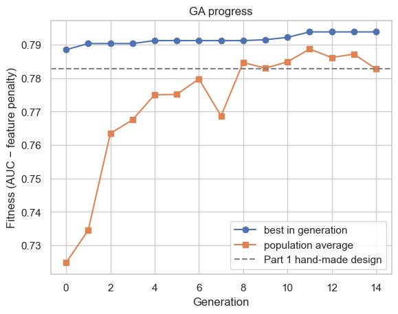
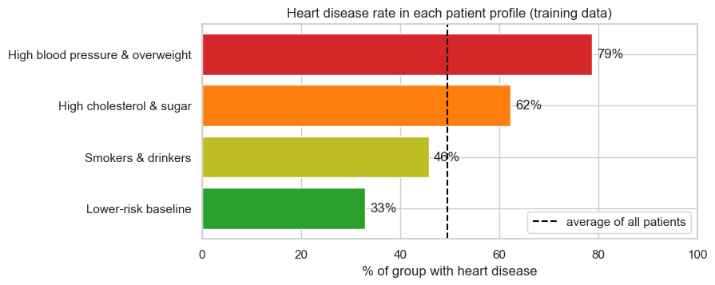
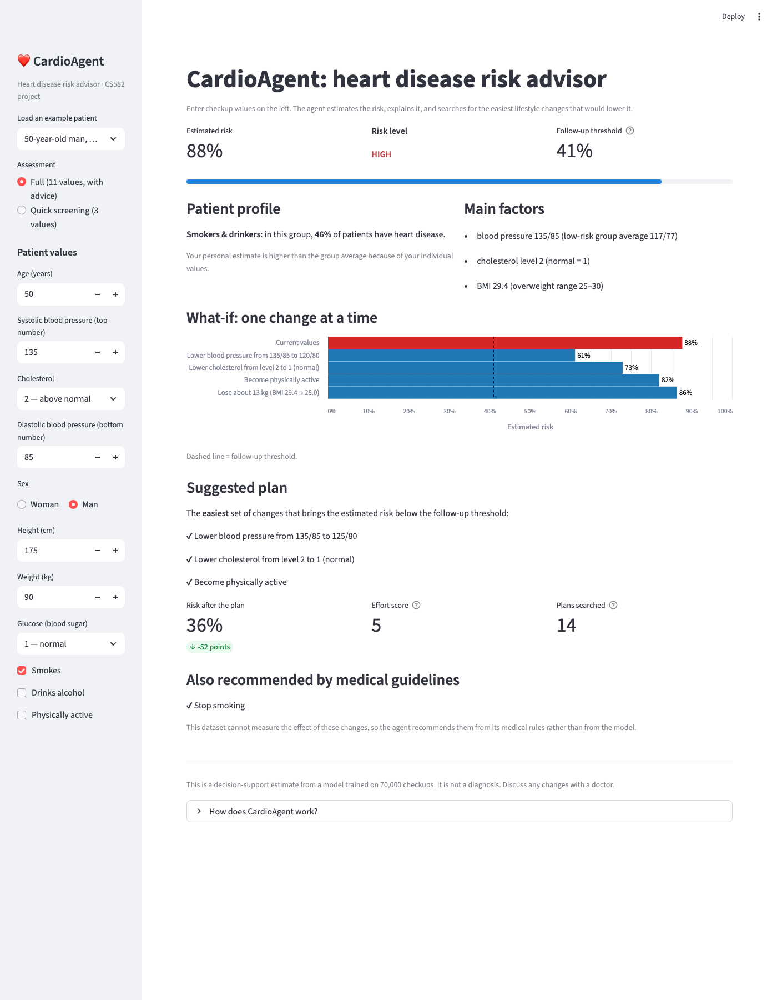

# CardioAgent — Heart Disease Risk Advisor

CS582 Machine Learning group project. CardioAgent predicts cardiovascular disease from routine checkup data and
recommends the easiest lifestyle changes that would lower a patient's risk.

**Dataset:** [Kaggle Cardiovascular Disease dataset](https://www.kaggle.com/datasets/sulianova/cardiovascular-disease-dataset),
70,000 patients (68,559 after cleaning), split 70/15/15 into train, validation and test sets.

## Novelty: a neuro-symbolic agent

- **Neural network:** an MLP estimates each patient's risk of heart disease.
- **Knowledge base:** medical rules validate input and allow only healthy changes. They also block advice the data gets
  wrong: the model predicts that quitting smoking *raises* risk for 55% of patients, and cutting alcohol for 71%. The
  agent gives that advice from guidelines instead.
- **Uniform-cost search:** finds the lowest-effort combination of changes (lower BP, lower cholesterol, lose weight,
  become active) that brings the predicted risk below the follow-up threshold.
- **Genetic algorithm:** designs the network, choosing both the input features and the hidden-layer shape.

## Project structure

| File | Contents |
|---|---|
| `01_cardio_basics.ipynb` | Data cleaning, EDA, MLP, comparison with SVM / Random Forest / Naive Bayes, threshold choice |
| `02_genetic_algorithm_design.ipynb` | GA selects features and MLP shape |
| `03_patient_profiles.ipynb` | PCA, LDA, k-means and SOM find patient profiles |
| `04_agent.ipynb` | Agent demonstration, safety check and evaluation |
| `cardio_utils.py` | Shared data loading, cleaning, splitting and scaling |
| `cardio_agent.py` | The `CardioAgent` class: perceive → think (predict, profile, plan) → act |
| `app.py` | Streamlit demo app |
| `results/` | Saved GA design, patient profiles and agent evaluation (used by the agent) |
| `data/cardio_train.csv` | Dataset |

## How to run

Requires Python 3.10+.

```bash
pip install -r requirements.txt
streamlit run app.py          # demo app at http://localhost:8501 (add ?example=1 to load an example)
```

Run the notebooks in order (01 → 04); notebooks 02 and 03 write the files in `results/` that the agent uses.

## Results (test set)

| Model | Features | Threshold | Accuracy | Precision | Recall | ROC-AUC |
|---|---|---|---|---|---|---|
| MLP (16, 8) | 10 | 0.41 | 0.716 | 0.685 | 0.789 | 0.794 |
| GA-designed MLP (32, 16) | 3 (BP, cholesterol, age) | 0.36 | 0.710 | 0.677 | 0.790 | 0.789 |

Thresholds are the highest values that keep validation recall ≥ 0.80.

- **Prediction:** MLP, SVM and Random Forest all reach about 73% accuracy at threshold 0.5. The ceiling comes from
  the data, not the model.
- **GA:** 3 features match the full 10-feature model. LDA independently picks the same three.
- **Patient profiles:** k-means finds 4 groups with disease rates from 33% to 79%, and the SOM agrees.
- **Agent** (1,000 at-risk test patients): plans reach the threshold for 66% of patients and lower average predicted
  risk from 71% to 39%. 0 of 1,000 plans include an unhealthy change.

<p>
  
  
</p>
<p>
  
  
</p>

## Limitations and future work

- Plans are model estimates from observational data, not proven causal effects.
- The data has no family history, ECG or medication information, and no clinician has evaluated the tool.
- Effort costs are hand-set; future work could learn them from patient preferences or clinical data.

## References

1. Detrano, R., et al. (1989). International application of a new probability algorithm for the diagnosis of coronary
   artery disease. *The American Journal of Cardiology*, 64(5), 304–310.
2. Weng, S. F., Reps, J., Kai, J., Garibaldi, J. M., & Qureshi, N. (2017). Can machine-learning improve cardiovascular
   risk prediction using routine clinical data? *PLoS ONE*, 12(4), e0174944.
3. Dinh, A., Miertschin, S., Young, A., & Mohanty, S. D. (2019). A data-driven approach to predicting diabetes and
   cardiovascular disease with machine learning. *BMC Medical Informatics and Decision Making*, 19, 211.

*CardioAgent is a decision-support prototype, not a diagnostic tool.*
