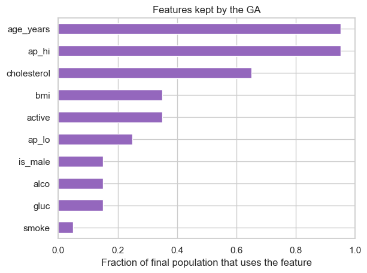
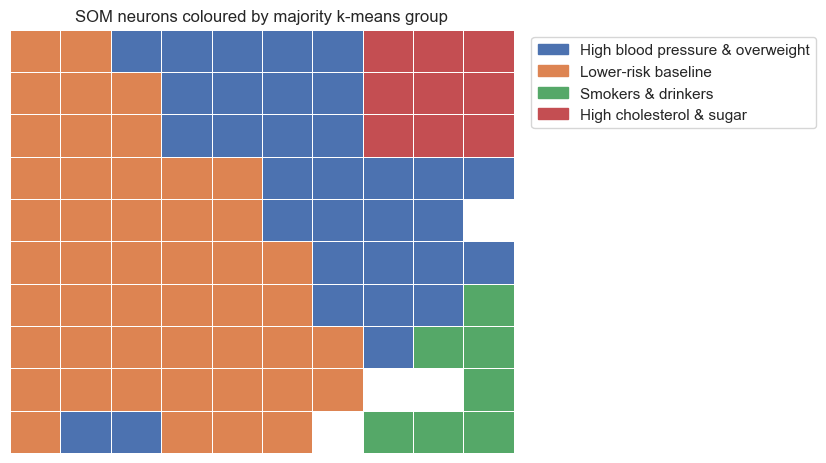
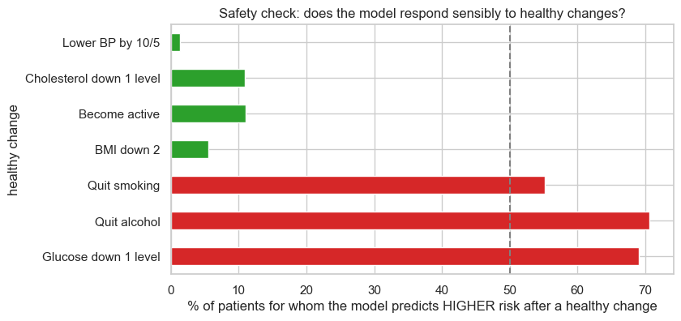
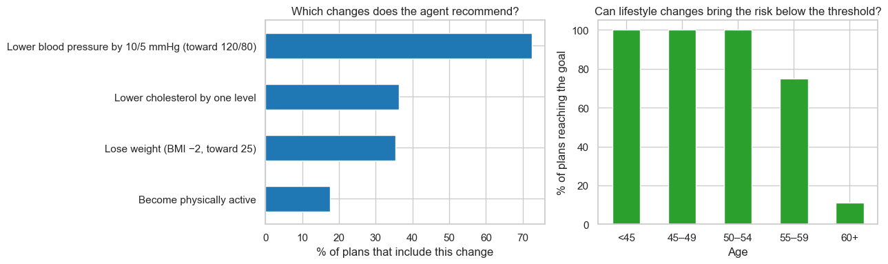
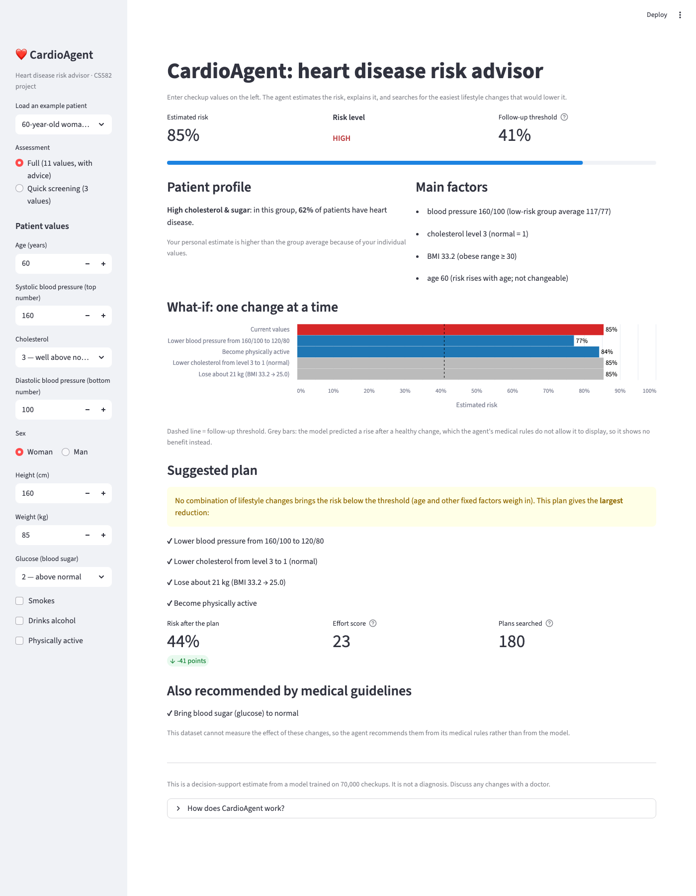

# CardioAgent — Heart Disease Risk Advisor

CS582 Machine Learning group project. Predicts cardiovascular disease from routine checkup data
(Kaggle Cardiovascular Disease dataset, 70,000 patients) and wraps the model in an intelligent agent.

> **New to the project?** Start with [`docs/Project_Overview.md`](docs/Project_Overview.md): the whole project from beginning
> to end in plain language.

## How to run

**1. Set up (once).** You need Python 3.10 or newer. From inside the `cardio_project` folder, install the libraries:

```bash
pip install -r requirements.txt
```

(If you use Anaconda, most of these are already installed.)

**2. Run the notebooks.** Open a notebook in VS Code or Jupyter, select a Python kernel that has the libraries above, then **Run All**.
Run the notebooks in order — Part 2 saves files that Part 4 uses.

**3. Demo app.** From inside the `cardio_project` folder run `streamlit run app.py` (opens http://localhost:8501; add `?example=1` to load an example patient).

## Troubleshooting

The notebooks already contain their saved results, so you can **read** them without running anything.
These are the common problems when you **run** them.

### `ModuleNotFoundError: No module named 'numpy'` (or `pandas`, `sklearn`, ...)

**Cause:** the notebook is connected to a Python that doesn't have the libraries installed. Many computers have more than
one Python (for example, a built-in system Python and an Anaconda Python), and the editor may pick the wrong one.

**Fix: select a kernel that has the libraries:**
1. In VS Code, click the kernel name in the **top-right corner** of the notebook.
2. Choose **Select Another Kernel… → Python Environments…**
3. Pick a Python that has the libraries (if you use Anaconda, choose its **base** environment).
4. Click **Restart**, then **Run All**.

The editor remembers the kernel per notebook, so repeat this once for each notebook.

**Or install the libraries into the Python you're using:** from inside the `cardio_project` folder, run
`pip install -r requirements.txt` with that same Python. (Inside a notebook cell you can run `%pip install -r requirements.txt`,
then restart the kernel.)

### `NameError: name 'agent' is not defined` (or `patient`, `data`, `examples`, ...)

**Cause:** cells were run **out of order**. Each cell uses variables created by earlier cells, so running a cell in the
middle of a notebook fails if the cells above it haven't run in the current session. The outputs you can see above it were
saved from an earlier run; they don't mean those cells ran in your session. A small number in `Cell In[1]` or `Cell In[5]`
is a sign that only a few cells have run.

**Fix:** click **Restart**, then **Run All** in the notebook toolbar. All cells run top to bottom (Part 2 takes ~4 minutes,
the others under a minute). After that you can re-run or edit individual cells freely.

**Rule of thumb:** after opening a notebook or restarting the kernel, always **Run All** first.

### `FileNotFoundError: ... results/ga_best_design.json` (or `patient_profiles.json`)

**Cause:** the agent (Part 4 and the app) needs files created by Parts 2 and 3, and they haven't been created on this computer.

**Fix:** run `02_genetic_algorithm_design.ipynb` and `03_patient_profiles.ipynb` (**Run All**) first, then Part 4 or the app.
Also make sure you open the notebooks from inside the `cardio_project` folder, because the files are found relative to it.

### `streamlit: command not found`

**Cause:** the `streamlit` command isn't on your system's path, or Streamlit isn't installed.

**Fix:** run `python -m streamlit run app.py` instead, using the Python that has the libraries. If that also fails,
install the libraries with `pip install -r requirements.txt`.

## Project files

| File | What it is |
|---|---|
| `data/cardio_train.csv` | Raw dataset (semicolon-separated) |
| `cardio_utils.py` | Shared cleaning / feature engineering / split / scaling |
| `01_cardio_basics.ipynb` | Part 1 — the full ML workflow, explained step by step |
| `02_genetic_algorithm_design.ipynb` | Part 2 — GA chooses features + MLP shape |
| `results/ga_best_design.json` | GA's winning design (created by Part 2) |
| `docs/Project_Overview.md` | Plain-language overview of the whole project (start here) |
| `docs/Team_Plan.md` | How the 5 team members split the project, presentation outline, timeline |
| `docs/Part2_Genetic_Algorithm_Guide.md` | Study guide for Part 2 (diagrams, results, glossary, self-check) |
| `03_patient_profiles.ipynb` | Part 3 — PCA, LDA, k-means and SOM find patient profiles |
| `results/patient_profiles.json` | The 4 patient profiles (created by Part 3) |
| `docs/Part3_Patient_Profiles_Guide.md` | Study guide for Part 3 |
| `cardio_agent.py` | Part 4 — the CardioAgent class (knowledge base + planning search) |
| `04_agent.ipynb` | Part 4 — explains, demonstrates and evaluates the agent |
| `results/agent_evaluation.json` | Agent test results (created by Part 4) |
| `docs/Part4_Agent_Guide.md` | Study guide for Part 4 |
| `app.py` | Part 5 — Streamlit demo app (web form + report) |
| `requirements.txt` | Python libraries needed (`pip install -r requirements.txt`) |
| `docs/Part5_Demo_App_Guide.md` | How to run the app, what it shows, presentation demo script |

## Roadmap

| Part | Status | Course link | Novelty |
|---|---|---|---|
| 1. Basics: clean, EDA, MLP, SVM/RF/NB comparison, threshold | ✅ done | L4–6, 8, 15 | — |
| 2. GA selects features + MLP shape | ✅ done | L12–13 | ✔ model design by search |
| 3. Patient profiles: k-means / SOM, PCA / LDA plots | ✅ done | L7, 9, 10 | ✔ unsupervised risk groups |
| 4. Agent: predict + profile + what-if advice (search for smallest lifestyle change), PEAS | ✅ done | L11–12 | ✔ utility-based agent + neuro-symbolic safety rules + UCS planning |
| 5. Demo app (Streamlit) | ✅ done | — | — |
| 6. Paper + slides / video | ⬜ next | — | — |

## Part 2: Genetic algorithm model design

**Notebook:** [`02_genetic_algorithm_design.ipynb`](02_genetic_algorithm_design.ipynb) · **Full study guide:** [`docs/Part2_Genetic_Algorithm_Guide.md`](docs/Part2_Genetic_Algorithm_Guide.md) · **Runtime:** ~4 min

### In simple words (read this first)

**What is a "design"?** Before training a model, you answer two questions:

1. **Which patient information should the model look at?** (blood pressure yes, smoking no, age yes, ...)
2. **How big should the neural network be?** (small, medium or large)

One set of answers to both questions = **one design**.

**The pizza analogy.** Choosing a design is like ordering a pizza:

```
 TOPPINGS: 10 toppings, each one YES or NO      (= the 10 patient features)
 SIZE:     8 sizes to choose from               (= the 8 network sizes)

 → 8,192 different pizzas are possible
```

The only way to know if a pizza is good is to **bake it and taste it**. For us, that means **train the model and test it**,
which takes about 1 second each time.

**What "191 designs" means.** The genetic algorithm baked and tasted **191 different pizzas** out of the 8,192 possible,
and found one of the best:

```
 8,192 possible designs
 ▓▓▓▓▓▓▓▓▓▓▓▓▓▓▓▓▓▓▓▓▓▓▓▓▓▓▓▓▓▓▓▓▓▓▓▓▓▓▓▓▓▓▓▓▓▓▓▓▓▓▓▓▓▓▓▓▓▓▓▓▓▓▓
 █                                                ← only 191 tested (about 2%)
```

It didn't need to try them all, because it chose smartly: it kept the good pizzas, mixed their toppings, and made
small random changes. That's evolution, and that's what a genetic algorithm does.

*Why 191 and not 300?* The GA ran 15 rounds of 20 designs (about 300 tastings), but it often made the same design again.
It remembered those scores instead of re-testing, so only 191 were different.

**What it found:**

```
 Best design:
   features: blood pressure + cholesterol + age     (only 3 of 10)
   network:  medium-large, (32, 16)

 → predicts just as well as using all 10 features
```

**Part 2 in three sentences:**
1. There are 8,192 ways to set up the model, and testing all of them would be slow.
2. A genetic algorithm tested only 191 of them, using evolution (keep the best, mix them, add small random changes).
3. It found that **3 pieces of patient information (blood pressure, cholesterol, age) are enough**: the model is just as
   accurate as with all 10.

---

*The rest of this section gives the technical details (for the paper and presentation).*

### Goal

In Part 1 two design choices were made by hand: **which features** the MLP uses (all 10) and **the network shape** (`(16, 8)`).
These are discrete choices, so backpropagation can't optimise them. Part 2 treats them as a **search problem**
(Lectures 11–13) and lets a genetic algorithm find the design.

| | |
|---|---|
| Search space | 2¹⁰ feature subsets × 8 network shapes = **8,192 designs** |
| Cost per design | one full MLP training (~1 s) |
| Designs the GA actually trained | **191** (2.3% of the space) |

### How it works

```
  20 random 13-bit chromosomes
          │
          ▼
  ┌───────────────┐   ┌────────────┐   ┌────────────┐   ┌────────────┐
  │ FITNESS       │──▶│ SELECTION  │──▶│ CROSSOVER  │──▶│ MUTATION   │──┐
  │ train MLP on  │   │ roulette   │   │ one cut,   │   │ 5% per bit │  │
  │ TRAIN, AUC on │   │ wheel      │   │ rate 0.9   │   │            │  │
  │ VALIDATION    │   └────────────┘   └────────────┘   └────────────┘  │
  └───────────────┘                                                   │
          ▲                  best 2 copied unchanged (elitism)        │
          └───────────────────────── next generation ◀────────────────┘   × 15
```

**Chromosome (13 bits):**

```
 bits 0–9  : one bit per feature (1 = use)   ap_hi ap_lo chol gluc smoke alco active age bmi is_male
 bits 10–12: shape index 0–7                 (4,) (8,) (16,) (32,) (8,4) (16,8) (32,16) (64,32)

 winner:   1 0 1 0 0 0 0 1 0 0 | 1 1 0   →  [ap_hi, cholesterol, age_years], shape (32, 16)
```

**Fitness:** `validation ROC-AUC − 0.002 × number of features`
- AUC instead of recall, because recall can be gamed by predicting "sick" for everyone.
- The penalty means a feature must add more than 0.002 AUC to be kept, so simpler designs win ties.
- Scores are cached, so a design produced twice is never retrained.

**GA settings:** population 20 · generations 15 · elitism 2 · one-point crossover 0.9 · bit-flip mutation 0.05 · seed 42

### Evaluation protocol

| Data split | Patients | Used for |
|---|---|---|
| Training | 47,991 | Learning MLP weights (the MLP's early stopping holds out 10% internally) |
| Validation | 10,284 | GA fitness, comparing designs, choosing the threshold |
| Test | 10,284 | Final score only, used **once** |

Checks against over-claiming:
1. **Random-search control** with the same budget (191 designs).
2. **5 training seeds** for both the GA design and the hand-made design.
3. **Threshold** chosen on validation (highest one giving recall ≥ 80%), then applied once to test.

### Results

GA progress, best fitness per generation:

| Gen | Best fitness | Best design |
|---|---|---|
| 0 | 0.7885 | 7 features, (16, 8) |
| 1 | 0.7903 | 5 features, (32,) |
| 4 | 0.7912 | 5 features, (64, 32) |
| 10 | 0.7922 | 4 features, (64, 32) |
| **11–14** | **0.7938** | **3 features, (32, 16)** |

For comparison, the Part 1 hand-made design has fitness 0.7829.

| Check | Result |
|---|---|
| GA vs random search (same budget) | 0.7938 vs 0.7903 |
| Validation AUC over 5 seeds: hand-made (10 features) | 0.8009 ± 0.0015 |
| Validation AUC over 5 seeds: **GA (3 features)** | **0.7995 ± 0.0002** |

**Test set** (threshold chosen on validation):

| Design | Features | Threshold | Accuracy | Precision | Recall | F1 | ROC-AUC |
|---|---|---|---|---|---|---|---|
| Hand-made MLP (16, 8) | 10 | 0.41 | 0.716 | 0.685 | 0.789 | 0.733 | 0.794 |
| **GA MLP (32, 16)** | **3** | **0.36** | **0.710** | **0.677** | **0.790** | **0.729** | **0.789** |

<p>
  
  
</p>

Features kept by the final population: `age_years` and `ap_hi` 95%, `cholesterol` 65%, `bmi` and `active` 35%, `ap_lo` 25%,
`is_male`, `alco` and `gluc` 15%, `smoke` 5%.

### Findings

1. **Same performance with 70% fewer inputs.** The 3-feature design matches the 10-feature design: the AUC gap
   (~0.001) is within seed-to-seed variation, and test recall is 79% for both.
2. **Blood pressure, cholesterol and age carry almost all the signal.** This agrees with Part 1's correlation analysis and
   Random Forest importance: three independent methods give the same answer.
3. **Lifestyle features add little to prediction** in this dataset, likely because they are self-reported.
4. **Consequence for the agent (Part 4):** the GA model is used for **screening predictions**, while a full-feature model
   answers **what-if** questions ("what if I quit smoking?"), because the GA model never sees lifestyle inputs.

### Limitations

- The GA's margin over random search is small (0.794 vs 0.790). Many designs score nearly as well, consistent with
  the data-limited ceiling seen in Part 1.
- Results come from one GA run (seed 42). Repeating with several GA seeds would strengthen the comparison.
- Fitness uses a single validation split. k-fold cross-validation would be more robust, but about 5× slower.
- The GA selected on validation hundreds of times, so its validation score is optimistic. Only test numbers should be reported.

### Output

`results/ga_best_design.json` stores the winning features, shape, chromosome, threshold, test metrics and GA settings.
Part 4 loads it instead of re-running the GA.

### Reproduce or experiment

Run the notebook top to bottom. Settings worth changing (one at a time) are near the top of each step:

| Setting | Default | Try |
|---|---|---|
| `FEATURE_PENALTY` | 0.002 | 0 (features are free) or 0.01 (strong push to fewer features) |
| `MUTATION_RATE` | 0.05 | 0.2 (behaves more like random search) |
| `POPULATION_SIZE` / `GENERATIONS` | 20 / 15 | 40 / 20 (wider search, slower) |
| `ARCHITECTURES` | 8 shapes | add shapes; 9–16 shapes need `N_SHAPE_BITS = 4` |

## Part 3: Patient profiles (unsupervised learning)

**Notebook:** [`03_patient_profiles.ipynb`](03_patient_profiles.ipynb) · **Full study guide:** [`docs/Part3_Patient_Profiles_Guide.md`](docs/Part3_Patient_Profiles_Guide.md) · **Runtime:** < 1 min

### In simple words (read this first)

Parts 1–2 asked *"does this patient have heart disease?"* and learned from the answers.
Part 3 asks *"what **kinds** of patients are there?"*. We **hide the answers** and let the computer group similar
patients by itself. Only afterwards do we check how many in each group have heart disease.

It found **four kinds of patients**:

| Group | What they have in common | Have heart disease |
|---|---|---|
| High blood pressure & overweight | BP ≈ 143/90, BMI ≈ 30, older | **79%** |
| High cholesterol & sugar | very high cholesterol and glucose | **62%** |
| Smokers & drinkers | 90% smoke, 89% men | **46%** |
| Lower-risk baseline | normal BP and cholesterol, younger | **33%** |

The computer never saw who was sick, yet its groups range from 33% to 79% disease. The agent (Part 4) will use them
to explain a patient's risk in plain words: *"you are in the high blood pressure group, where 79% have heart disease."*

---

*Technical details:*

| Method | Lecture | What it showed |
|---|---|---|
| **PCA** | 7 | 2 components keep 38% of the spread. PC1 = overall health risk (BP, cholesterol, BMI, age), PC2 = male smoker/drinker. Sick and healthy patients **overlap heavily**, which explains the ~73% accuracy ceiling |
| **LDA** | 7 | Best separating direction is built from **ap_hi (0.86), age (0.36), cholesterol (0.33)**, the same features the GA chose. Validation AUC **0.795** ≈ MLP, so the patterns are mostly linear |
| **K-means** (k = 4, `n_init=10`) | 9 | Four profiles above. No sharp elbow and silhouette ≈ 0.2 for every k, so k = 4 was chosen for interpretability |
| **SOM** (10 × 10, written in NumPy) | 10 | Self-organises into low- and high-risk regions; each k-means group occupies mostly one connected region of the map, so two algorithms agree |
| **Profile-only predictor** | 6 | Using only the group's disease rate: validation AUC **0.709** (vs 0.80 for the MLP), so profiles are an explanation layer, not a replacement |

<p>
  
  
</p>

**Limitations:** the groups are soft regions rather than sharply separated clusters (silhouette ≈ 0.2); k = 4 is a judgement call;
the 2-D PCA view keeps only 38% of the information.

**Output:** `results/patient_profiles.json` stores the k-means centres (scaled), group names, sizes, disease rates and average patient.

## Part 4: CardioAgent, the intelligent agent

**Notebook:** [`04_agent.ipynb`](04_agent.ipynb) · **Agent code:** [`cardio_agent.py`](cardio_agent.py) · **Full study guide:** [`docs/Part4_Agent_Guide.md`](docs/Part4_Agent_Guide.md) · **Runtime:** ~15 s

### In simple words (read this first)

Part 4 joins Parts 1–3 into **one assistant**. You give it a patient's checkup values; it gives back the risk, the patient's group,
the main factors, and the **easiest set of lifestyle changes** that would bring the risk down:

```
 Risk 88% (HIGH) · group: "smokers & drinkers" · factors: blood pressure, cholesterol, weight
 Easiest plan: lower BP to 125/80 + cholesterol to normal + become active → about 36%
 Also: stop smoking (medical advice) · Not a diagnosis, talk to a doctor.
```

**The surprise:** the model predicted that **quitting smoking raises risk**. It learned patterns from this dataset, not real causes.
So the agent has a small **rule book** of medical facts that decides which changes are healthy; the model only estimates how much they help.
Mixing a learned model with rules is called **neuro-symbolic AI**.

---

*Technical details:*

| Component | Source | Role |
|---|---|---|
| Full MLP (16, 8), 10 features, threshold 0.41 | Part 1 | Full assessment, what-if, planning |
| Quick MLP (32, 16), 3 features, threshold 0.36 | Part 2 GA | Screening when only age, BP, cholesterol are known |
| 4 k-means profiles | Part 3 | Explains the patient's group |
| Knowledge base | new | Input limits; 4 allowed healthy changes; smoking/alcohol/glucose advice from guidelines only; a healthy change is never shown as harmful |
| Uniform-cost search (A\* with h = 0) | Lecture 12 | Cheapest plan (effort costs: BP 2, cholesterol 2, weight 2, active 1) with risk < threshold |

**PEAS:** Performance = recall ≥ 80%, safe and low-effort advice · Environment = checkup records · Actuators = written report ·
Sensors = 11 input values (or 3). **Agent type:** utility-based.

**Safety check (validation):** after a *healthy* change the full MLP predicts **higher** risk for 55% of smokers who quit, 71% who quit alcohol,
69% whose glucose drops, versus 1–11% for BP, cholesterol, activity and weight. This motivates the knowledge base.

**Test-set results:**

| Measure | Result |
|---|---|
| Recall: full / quick mode | 0.789 / 0.790 (ROC-AUC 0.794 / 0.789) |
| Flagged patients whose plan reaches the goal (sample of 1,000) | **66%** (100% under 55, ~75% at 55–59, ~11% at 60+) |
| Average estimated risk before → after plan | **71% → 39%** |
| Median effort / states explored | 4 / 13 |
| Plans recommending an unhealthy change | **0** |
| What-if answers corrected by the knowledge base | **18%** (112 of 619) |
| UCS vs. brute force (example patient) | same optimal cost (5); UCS explored 14 of 48 states |

<p>
  
  
</p>

**Limitations:** what-if effects are model associations, not causal; effort costs are our judgement; only 11 checkup values;
not evaluated by clinicians; full and quick modes can give slightly different risk numbers.

**Use it:**

```python
from cardio_agent import CardioAgent
agent = CardioAgent()
print(agent.report({"age_years": 50, "is_male": 1, "height_cm": 175, "weight_kg": 90, "ap_hi": 135, "ap_lo": 85,
                    "cholesterol": 2, "gluc": 1, "smoke": 1, "alco": 0, "active": 0}))
```

## Part 5: Demo app

**Code:** [`app.py`](app.py) · **Guide (with presentation demo script):** [`docs/Part5_Demo_App_Guide.md`](docs/Part5_Demo_App_Guide.md)

### In simple words

A simple web page for the agent: type a patient's values into the form on the left, and the report appears on the right
(risk, profile, factors, what-if chart, plan, guideline advice). It's the same agent as Part 4, with the same numbers;
the app only draws the screen.

```bash
cd cardio_project            # the project folder, wherever you saved it
streamlit run app.py         # then open http://localhost:8501/?example=1
```

<p>
  
  
</p>

Tested with Streamlit's automated testing tool (three examples, quick mode, invalid input: no errors, numbers match the
notebook) and with real-browser screenshots.

## Key results so far

| Model | Features | Test accuracy | Test recall | Test ROC-AUC |
|---|---|---|---|---|
| MLP (16, 8), Part 1, threshold 0.40 | 10 | 0.712 | 0.797 | 0.794 |
| MLP (32, 16), GA design, threshold 0.36 | 3 (ap_hi, cholesterol, age) | 0.710 | 0.790 | 0.789 |

The Part 1 row uses Part 1's threshold search (steps of 0.05 → 0.40). Part 2 searches in steps of 0.01, which gives 0.41
for the same model (test recall 0.789). Both are valid; use one convention consistently in the paper.

- MLP, SVM and Random Forest all reach ≈ 73–74% accuracy at threshold 0.5 → the ceiling comes from the data.
- The GA found that **blood pressure, cholesterol and age** carry almost all the predictive information. LDA (Part 3) picks the same three.
- Unsupervised learning found four patient profiles with disease rates from 33% to 79%, and k-means and SOM agree on them.
- The agent's plans bring average estimated risk from 71% to 39%; a knowledge base blocks advice the data gets wrong (e.g. "quitting smoking raises risk").

## Novelty and contributions

1. **Neuro-symbolic safety layer :** the model predicted that quitting smoking *raises* risk, because it learned patterns in the data, not causes. So a knowledge base decides which changes are healthy, and the model only estimates how much they help. Smoking, alcohol and glucose advice comes from medical guidelines. Result: 0 of 1,000 test plans recommend an unhealthy change.
2. **Model design by genetic algorithm:** a GA searched 8,192 feature/network designs (fitness = validation AUC − 0.002 × features) and found that 3 features (blood pressure, cholesterol, age) match the 10-feature model (test recall 0.790 vs 0.789), enabling a quick 3-value screening.
3. **Unsupervised risk profiles:** k-means and a self-organising map found 4 patient groups with 33%–79% heart disease, which the agent uses to explain each prediction in plain words.
## References

1. Detrano, R., et al. (1989). International application of a new probability algorithm for the diagnosis of coronary
   artery disease. *The American Journal of Cardiology*, 64(5), 304–310.
   The origin of the UCI Heart Disease (Cleveland) dataset: a probability model built at one hospital and tested at
   others. Shows the problem this project starts from: estimating heart disease risk from routine patient data.
2. Weng, S. F., Reps, J., Kai, J., Garibaldi, J. M., & Qureshi, N. (2017). Can machine-learning improve cardiovascular
   risk prediction using routine clinical data? *PLoS ONE*, 12(4), e0174944.
   Compares random forest, logistic regression, gradient boosting and neural networks against the standard clinical risk
   score on routine records; the neural network did best. Supports our choice of an MLP and our model comparison (Part 1).
3. Dinh, A., Miertschin, S., Young, A., & Mohanty, S. D. (2019). A data-driven approach to predicting diabetes and
   cardiovascular disease with machine learning. *BMC Medical Informatics and Decision Making*, 19, 211.
   Predicts cardiovascular disease from survey and checkup data with several ML models and ranks which features matter
   most. Compare with our GA (Part 2) and LDA (Part 3), which both find blood pressure, cholesterol and age.
