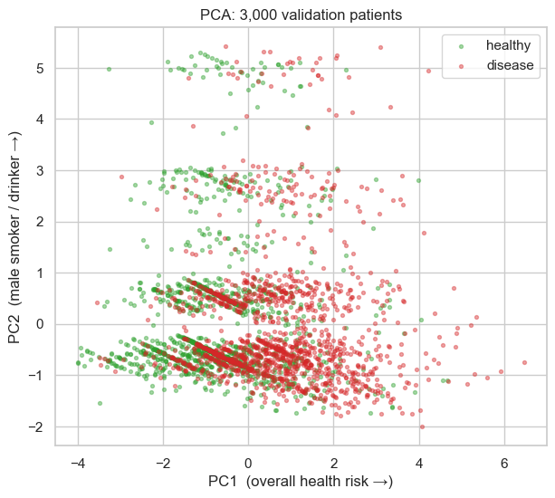
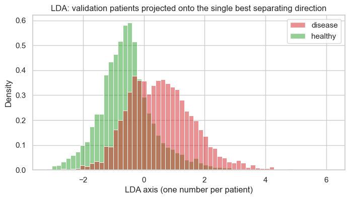
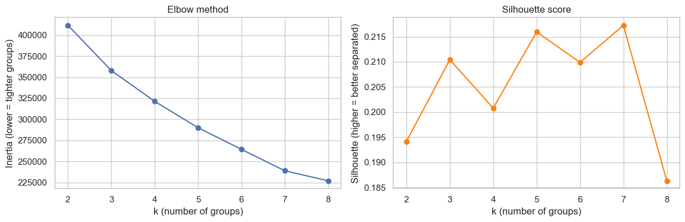
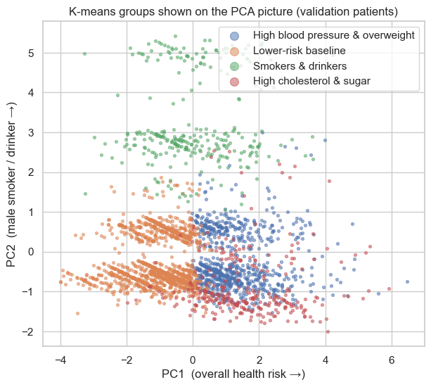
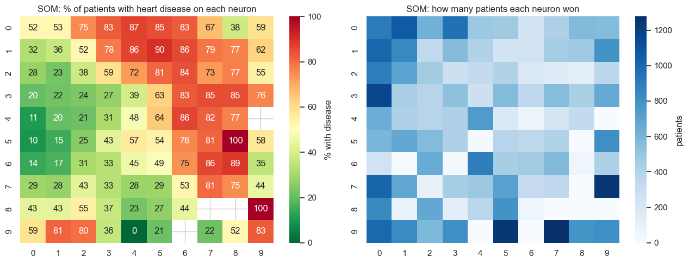
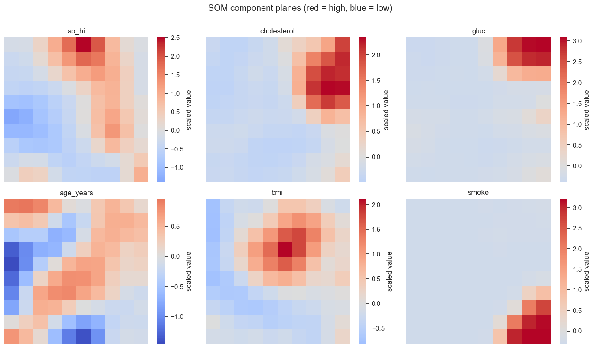

# Part 3: Patient Profiles (Unsupervised Learning)

**Project:** CardioAgent, heart disease risk prediction (CS582 Machine Learning)
**Notebook:** [`03_patient_profiles.ipynb`](../03_patient_profiles.ipynb) · **Runtime:** under 1 minute
**Course link:** Lecture 7 (PCA, LDA), Lecture 9 (k-means), Lecture 10 (competitive learning, SOM)

---

## Contents

1. [In simple words (read this first)](#1-in-simple-words-read-this-first)
2. [Files](#2-files)
3. [Supervised vs. unsupervised](#3-supervised-vs-unsupervised)
4. [PCA: a 2-D picture of the patients](#4-pca-a-2-d-picture-of-the-patients)
5. [LDA: the best line to separate sick from healthy](#5-lda-the-best-line-to-separate-sick-from-healthy)
6. [K-means: finding groups of similar patients](#6-k-means-finding-groups-of-similar-patients)
7. [The four patient profiles](#7-the-four-patient-profiles)
8. [SOM: a map of all patients](#8-som-a-map-of-all-patients)
9. [Do the profiles help predict disease?](#9-do-the-profiles-help-predict-disease)
10. [What to say in the presentation and paper](#10-what-to-say-in-the-presentation-and-paper)
11. [Glossary](#11-glossary)
12. [Check your understanding](#12-check-your-understanding)
13. [Try it yourself](#13-try-it-yourself)

---

## 1. In simple words (read this first)

**Parts 1 and 2** asked: *"Does this patient have heart disease?"* We gave the model the right answers to learn from.

**Part 3 asks:** *"What **kinds** of patients are there?"* This time we **hide the answers** and let the computer
sort patients into groups by itself, the way you might sort a pile of photos into piles of similar photos
without anyone telling you the categories.

```
  48,000 patients, answers HIDDEN
               │
               ▼
     computer groups similar patients
               │
     ┌─────────┼──────────┬───────────────┐
     ▼         ▼          ▼               ▼
  Group A   Group B    Group C         Group D
               │
               ▼
  only NOW we look at the answers:
  "how many in each group have heart disease?"
```

**What it found: four kinds of patients.**

| Group | What they have in common | How many have heart disease |
|---|---|---|
| 🔴 High blood pressure & overweight | blood pressure ≈ 143/90, overweight, older | **79%** |
| 🟠 High cholesterol & sugar | very high cholesterol and blood sugar | **62%** |
| 🟡 Smokers & drinkers | mostly men who smoke, some drink | **46%** |
| 🟢 Lower-risk baseline | normal blood pressure and cholesterol, younger | **33%** |

The surprising part: **the computer never saw who was sick**, yet the groups it made have very different
disease rates, from 33% to 79%. The groups are medically meaningful.

**Why this matters for the project:** the agent (Part 4) can say *"You are in the 'high blood pressure & overweight'
group, where 79% of patients have heart disease."* That's easier to understand than just "your risk is 0.72".

**Part 3 in three sentences:**
1. We hid the diagnosis and let two algorithms (k-means and SOM) group similar patients.
2. Both found the same four patient types, with disease rates from 33% to 79%.
3. These groups don't replace the risk prediction; they **explain** it in plain words.

---

## 2. Files

```
 cardio_utils.py ──▶ 03_patient_profiles.ipynb ──▶ results/patient_profiles.json ──▶ Part 4 agent
 (same data prep)    (PCA, LDA, k-means, SOM)      (the 4 groups: centres, names,
                                                    disease rates, average patient)
```

| File | Role |
|---|---|
| [`03_patient_profiles.ipynb`](../03_patient_profiles.ipynb) | All Part 3 analysis, explained step by step |
| `results/patient_profiles.json` | The 4 groups, saved so the agent can place a new patient into a group |

**Data used:** the k-means model, SOM, PCA and LDA all **learn from the 47,991 training patients** only.
The 10,284 validation patients are used to draw pictures and check results. The test set is not used in Part 3.

---

## 3. Supervised vs. unsupervised

```
 SUPERVISED (Parts 1–2)                       UNSUPERVISED (Part 3)
 patient data + the answer                    patient data only
        ▼                                            ▼
 learn to PREDICT the answer                  find GROUPS of similar patients
        ▼                                            ▼
 "this patient: 72% risk"                     "this patient looks like group 3"
```

**How can a computer tell that two patients are "similar"?** Think of each patient as a **point**. With 2 features
(blood pressure and age) each patient is a dot on a graph, and similar patients are dots that are **close together**.
We have 10 features, so each patient is a point in 10 dimensions. The idea is the same, it just can't be drawn.

**Why the data must be scaled first:** "close" is measured by distance. Without scaling, blood pressure (≈ 120)
would overwhelm smoking (0 or 1), and the groups would be based almost only on blood pressure.

---

## 4. PCA: a 2-D picture of the patients

**Problem:** we can't draw 10 dimensions.
**PCA (Lecture 7)** finds the two directions that capture the most **spread** in the data, so we can draw a flat picture.
It never looks at the answer.

| Component | Mostly made of | Meaning |
|---|---|---|
| **PC1** | blood pressure, cholesterol, BMI, age, glucose | an **"overall health risk"** axis |
| **PC2** | is_male, smoke, alco | a **"male smoker / drinker"** axis |

PC1 and PC2 together keep only **38%** of the information, so the picture is a sketch, not the whole story.



**What it shows:** red (disease) is more common on the right (higher risk), but **red and green overlap heavily**.
Many sick and healthy patients have very similar checkup values. **This is why every model in Part 1 got stuck near 73% accuracy.**

*The stripes:* many features take only a few values (cholesterol 1/2/3, smoking 0/1), so patients line up in bands.
The bands at the top are smokers and drinkers.

---

## 5. LDA: the best line to separate sick from healthy

**LDA (Lecture 7)** is like PCA but **uses the answers**. It finds the single direction that best separates sick from healthy.

| | PCA | LDA |
|---|---|---|
| Uses the answers? | No | **Yes** |
| Looks for | the most **spread** | the best **separation** between classes |
| Number of directions | up to 10 | classes − 1 = **1** |



**Three findings:**
1. The two humps are shifted apart but **overlap a lot**, the same message as PCA.
2. The LDA direction is built mostly from **blood pressure (0.86), age (0.36) and cholesterol (0.33)**:
   **the same three features the GA picked in Part 2.**
3. Used as a simple classifier, LDA gets validation AUC **0.795**, almost the same as the neural network (≈ 0.80).
   A straight-line method nearly matches the MLP, so the patterns in this data are **mostly linear**.

---

## 6. K-means: finding groups of similar patients

### How k-means works (Lecture 9)

```
 1. Choose k = how many groups.
 2. Drop k "centres" at random.
 3. ASSIGN: every patient joins the nearest centre.
 4. UPDATE: move each centre to the middle of its patients.
 5. Repeat 3–4 until the centres stop moving.
```

```
   start                     centres move                  final
   ×        ·  ·  ·          · · ·    ×                     ● ● ●    ◆
       ·  ·  · ×   ·         ×   · ·  · ·                  ●  ●  ●  ◆ ◆
   ·  ·  ×   ·  ·  ·         · ·    ·  ×  ·               ▲ ▲   ◆  ◆
   (× = centres)             toward the groups              3 groups found
```

A simple analogy: k ice-cream trucks in a park. Each person walks to the nearest truck; then each truck drives to
the middle of its crowd; people re-choose the nearest truck; repeat until no truck moves.

`n_init=10` runs the whole process 10 times from different random starts and keeps the best, because a bad start
can lead to a poor result (Lecture 9: local minimum).

### Choosing k (how many groups)



| k | 2 | 3 | **4** | 5 | 6 | 7 | 8 |
|---|---|---|---|---|---|---|---|
| Silhouette | 0.194 | 0.210 | **0.201** | 0.216 | 0.210 | 0.217 | 0.186 |

- **Elbow method:** look for where the curve bends sharply. Here it bends **gently**, with no clear elbow.
- **Silhouette score** (−1 to 1, higher = better-separated groups): all around 0.2, so no k is clearly best.

**Honest conclusion:** patients don't fall into sharply separated groups. They form one big cloud with softer regions,
which is normal for medical data. So we chose **k = 4 because it gives groups a person can understand**, with a silhouette
score as good as the others.

---

## 7. The four patient profiles

After grouping, we computed the **average patient** in each group, and only then looked at the disease rate.

| Profile | Patients | Disease rate | BP | Cholesterol (1–3) | Glucose (1–3) | Smoke | Age | BMI | Male |
|---|---|---|---|---|---|---|---|---|---|
| **High blood pressure & overweight** | 13,158 | **79%** | 143/90 | 1.51 | 1.08 | 0% | 55.5 | 30.4 | 30% |
| **High cholesterol & sugar** | 4,592 | **62%** | 130/83 | 2.37 | 2.76 | 3% | 55.7 | 29.0 | 27% |
| **Smokers & drinkers** | 4,494 | **46%** | 127/82 | 1.32 | 1.15 | 90% | 52.2 | 26.8 | 89% |
| **Lower-risk baseline** | 25,747 | **33%** | 117/77 | 1.11 | 1.04 | 0% | 51.9 | 25.8 | 29% |
| *All patients* | *47,991* | *49%* | *127/81* | *1.36* | *1.23* | *9%* | *53.3* | *27.5* | *35%* |


**How the groups are named:** the code names each group by its standout feature (highest blood pressure, most smokers,
highest glucose, and the one left over). This keeps the names correct even if the group numbers change.

**Notice:** the smokers group has a *lower* disease rate than the cholesterol group. This matches Parts 1–2,
where smoking added little to predictions in this dataset (smoking is self-reported here).

### The groups on the PCA picture



- High blood pressure group → **right** (high risk axis)
- Smokers & drinkers → **top** (smoker axis)
- Baseline → **left**
- Cholesterol & sugar → **lower right**, overlapping the blood-pressure group

The groups touch each other, again showing there are no sharp borders.

---

## 8. SOM: a map of all patients

### The idea (Lecture 10)

A **Self-Organising Map** is a grid of neurons (here 10 × 10 = 100). Each neuron stores a "typical patient".
Training makes **similar patients land on nearby neurons**, so the grid becomes a map of patient types.

```
 for 20,000 steps:
   1. pick a random patient
   2. COMPETE:   find the neuron closest to that patient → the WINNER
   3. COOPERATE: move the winner toward the patient,
                 and its grid NEIGHBOURS too, but less the further away they are
   4. slowly shrink the step size and the neighbourhood
```

The **neighbourhood function** decides how much each neuron moves:

$$h = \exp\left(-\frac{\text{grid distance to winner}^2}{2\sigma^2}\right)$$

```
   how much each neuron moves (winner in the middle):
   ░ ░ ▒ ░ ░
   ░ ▒ ▓ ▒ ░        ▓ = winner, moves most
   ▒ ▓ █ ▓ ▒        ▒ = neighbours, move less
   ░ ▒ ▓ ▒ ░        ░ = far away, barely move
   ░ ░ ▒ ░ ░
```

This is the difference from k-means: **k-means groups have no "neighbours"; SOM neurons do.** That's why the SOM
produces a smooth map. The code writes the SOM from scratch in about 20 lines of NumPy, so you can see every step.

### What the map shows



**Left:** % of patients with heart disease on each neuron. Red squares sit next to red, green next to green: the map
has organised itself into **low-risk and high-risk regions** without ever seeing the diagnosis.
White squares won no patients; values like 0 or 100 come from neurons with very few patients, so ignore those.



**Component planes:** the same map, coloured by one feature at a time. High blood pressure sits in the top-middle
(where the disease map is red), high cholesterol and glucose in the top-right, smoking in the bottom-right,
and younger age on the left (the green, low-risk area).


**SOM vs. k-means:** each neuron is coloured by the k-means group most of its patients belong to. Each group sits in
**mostly one connected region** (with a small stray patch). Two completely different algorithms found the
**same four patient types**, which is strong evidence that the groups are real.

---

## 9. Do the profiles help predict disease?

A simple test: give each validation patient **only their group's disease rate** as their risk score.

| Method | Validation ROC-AUC |
|---|---|
| Random guessing | 0.500 |
| **Profile only** (4 groups, formed without seeing answers) | **0.709** |
| LDA (straight line, 10 features) | 0.795 |
| MLP from Parts 1–2 | ≈ 0.80 |

- Knowing **only which of the 4 groups** a patient belongs to already beats guessing by a wide margin.
- The MLP is still better, because it uses each patient's exact numbers.

**Conclusion:** the profiles are an **explanation layer**, not a replacement. In Part 4:
- the **MLP** gives the risk number
- the **profile** describes the patient in plain words

---

## 10. What to say in the presentation and paper

1. **Method:** unsupervised k-means (k = 4) and a 10 × 10 SOM written from scratch, both on scaled features with the diagnosis hidden;
   PCA and LDA for visualisation (Lecture 7).
2. **Result:** four medically meaningful profiles with disease rates from **33% to 79%**, found without labels.
3. **Agreement:** k-means and SOM independently found the same profiles.
4. **Insight 1:** PCA shows heavy overlap between sick and healthy patients, which explains the ~73% accuracy ceiling.
5. **Insight 2:** LDA nearly matches the MLP (AUC 0.795 vs 0.80), so the patterns are mostly linear, and LDA's top features
   (blood pressure, age, cholesterol) match the GA's choice from Part 2.
6. **Use:** the profiles alone give AUC 0.71; they serve as the agent's explanation layer.

**Honest limitations:**
- Silhouette ≈ 0.2: the groups are soft regions of one cloud, not sharply separated clusters.
- k = 4 was chosen for interpretability, not because statistics clearly favoured it.
- The 2-D PCA picture keeps only 38% of the information.
- The SOM has some empty or nearly empty neurons, so its edge values are noisy.

---

## 11. Glossary

| Term | Meaning |
|---|---|
| **Supervised learning** | Learning from examples **with** the answers |
| **Unsupervised learning** | Finding structure **without** the answers |
| **Cluster / group / profile** | A set of patients who are similar to each other |
| **Centre (centroid)** | The average patient of a k-means group |
| **k** | The number of groups we ask k-means to find |
| **Inertia** | Total squared distance from patients to their centre (lower = tighter groups) |
| **Elbow method** | Choose k where the inertia curve stops dropping quickly |
| **Silhouette score** | How much closer patients are to their own group than to the next one (−1 to 1) |
| **PCA** | Finds new axes that keep the most spread; unsupervised |
| **Principal component (PC)** | One of those new axes, a mix of the original features |
| **LDA** | Finds the direction that best separates the classes; supervised |
| **SOM** | A grid of neurons trained so similar patients land on nearby neurons |
| **Winner / BMU** | The SOM neuron closest to a given patient (Best Matching Unit) |
| **Neighbourhood function** | Decides how much the winner's neighbours also move (shrinks over time) |
| **Component plane** | A SOM map coloured by one feature |

---

## 12. Check your understanding

<details>
<summary>1. What is the main difference between Part 3 and Parts 1–2?</summary>

Parts 1–2 learned **with** the diagnosis (supervised). Part 3 hides the diagnosis and looks for groups of similar
patients (unsupervised). The diagnosis is only used afterwards, to describe the groups.
</details>

<details>
<summary>2. Why must the data be scaled before k-means?</summary>

K-means measures distance. Without scaling, large-number features like blood pressure would dominate the distance,
and small ones like smoking (0/1) would be ignored.
</details>

<details>
<summary>3. Why did we choose k = 4 if the silhouette scores were all similar?</summary>

No k was clearly best statistically, so we chose the one giving groups a person can understand and act on.
That is a judgement call, and we state it as a limitation.
</details>

<details>
<summary>4. PCA and LDA both reduce dimensions. What is the difference?</summary>

PCA ignores the answers and keeps the most spread. LDA uses the answers and finds the direction that best separates
sick from healthy.
</details>

<details>
<summary>5. What does the SOM's neighbourhood function do?</summary>

It makes neurons near the winner also move toward the patient (less, the further away they are). This is why similar
patients end up on nearby neurons and the map forms smooth regions.
</details>

<details>
<summary>6. Why does the PCA picture explain the ~73% accuracy ceiling?</summary>

Sick and healthy patients overlap heavily: many have nearly identical checkup values. No model can separate patients
whose data looks the same.
</details>

<details>
<summary>7. If the profiles only reach AUC 0.71, why use them at all?</summary>

They are not used to predict; the MLP does that. They explain the prediction in words a person understands
("you are in the high blood pressure group").
</details>

---

## 13. Try it yourself

| Change | Question to answer |
|---|---|
| `K = 3` or `K = 5` (Step 5; adjust the naming rules in Step 6) | Do the groups still make sense? Which group splits or merges? |
| `GRID = 6` or `GRID = 15` (Step 7) | Is the SOM clearer or noisier? |
| `SIGMA_START = 0.5` (Step 7) | With almost no neighbourhood, does the map still form smooth regions? (Lab 6's question) |

**Next:** Part 4, the agent that combines the GA model (Part 2), the profiles (Part 3) and what-if advice.
